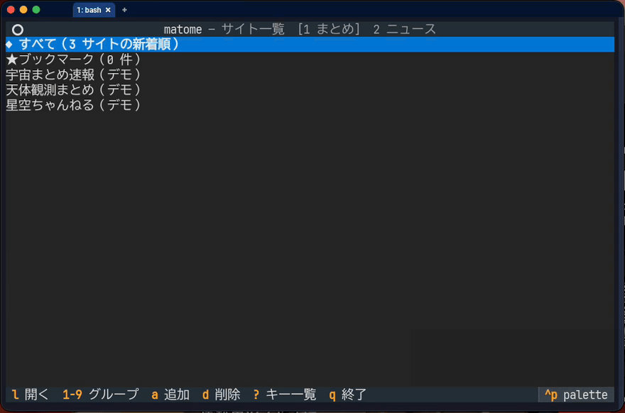

# matome

まとめサイトをターミナルで読む TUI。キー操作は vim 風で、画像は sixel / Kitty 対応端末ならインラインで表示する。
記事の中の動画（YouTube の埋め込みも）は外部のプレイヤーで再生でき、画像一覧・動画一覧で記事をまたいでタイル状に眺められる。



（デモのサイトと記事は架空のものです。画像は NASA のパブリックドメインの写真を使っています）

## セットアップ

Python 3.10 以上が必要。

```sh
# Linux / macOS / WSL
git clone https://github.com/synchrium/matome.git
cd matome
python3 -m venv .venv
.venv/bin/pip install -r requirements.txt
./matome
```

Ubuntu などで `python3 -m venv` が失敗するときは `sudo apt install python3-venv`。
`.venv` は作ったときの Python を指すので、Python を上げたあとに動かなくなったら `.venv` を作り直す。

どこからでも `matome` で起動するには、alias を作るか、`PATH` の通った場所にリンクを置く。

```sh
alias matome="/path/to/matome/matome"          # ~/.bashrc や ~/.zshrc に
ln -s "$PWD/matome" ~/.local/bin/matome        # または（matome のフォルダで実行）
```

```powershell
# Windows（PowerShell）
py -m venv .venv
.venv\Scripts\pip install -r requirements.txt
.venv\Scripts\python matome.py
```

## 画像表示

| 端末 | 表示 |
|---|---|
| Windows Terminal 1.22 以降、WezTerm、foot、iTerm2 | sixel でインライン表示 |
| Kitty、Ghostty | Kitty グラフィックスでインライン表示 |
| macOS のターミナル.app など | 文字（ハーフブロック）で近似表示 |

tmux や screen の中では表示が崩れることがある。

sixel は 256 色までなので、減色するときにディザをかけて、肌などのグラデーションに色のムラが出にくいようにしている（既定でオン）。
記事画面で `D` を押すとオン／オフが切り替わり、記事を開き直して描き直す。設定は保存される。
小さい画像（300×300 ピクセル以下。画像一覧のタイルなど）はムラが目立たないので、ディザをかけない（sixel が 2 割ほど小さく・速くなる）。

sixel は送るデータが大きい（タイル 1 枚で 60KB ほど）ので、SSH ごしでも重くならないように次のようにしている。

- 画面の端で一部しか見えていない画像は描かず、全部見えたら描く（画面より大きい画像は一部でも描く）。textual-image は見えている部分だけを sixel にするので、端の画像はスクロールのたびに作り直しになるため
- 画像一覧のカーソルは、フォーカスではなく目印（`cursor` クラス）で示す。フォーカスを移すと、見えている画像を全部描き直すため
- 画像一覧のスクロールにはアニメーションを使わない。読み込み中のタイルと画像は 0.4 秒ごとにまとめて画面に入れる
- 画像一覧に並べるタイルは画面 3 枚ぶんまで。残りは画像の取得だけ進めて手元に置き、カーソルが最後の行まで来たら次の分を並べる。並べたタイルが多いほど、画像を差し込むたび・カーソルを動かすたびの配置の計算が重くなるため（120 枚を全部並べていたときと比べ、最初の 1 画面まで約 1.6 秒 → 約 1.1 秒、カーソル移動の反応は約半分）。
- 拡大表示は、画面を開いて 0.3 秒たってから画像を出す。開いた直後は Textual が何度か描き直すので、すぐ出すとそのたびに sixel を送り直してちらつくため

記事の中の画像は幅 80 桁まで、高さは本文の枠の 3 割まで（縦長の画像は縮める。枠より高いと全体が一度に見えず、sixel では描かれなかった）。
画像をクリックすると、画像一覧の拡大と同じ画面で 1 枚だけ表示する（`n`/`p` で記事の中の次／前の画像、`q`・中クリックで記事に戻る）。

画像の大きさは、端末の 1 文字が何ピクセルかから決める。WSL2 の Windows Terminal から SSH でつなぐと、端末の大きさが 640×480 ピクセルという仮の値で届き、1 文字を 4×8 と見誤って画像が枠より小さく描かれる。
そのため、1 文字が 6×12 より小さいと見積もられたときは、Windows Terminal（と VT340）が sixel で使う 10×20 とみなす。合わないときは `MATOME_CELL_SIZE=10x20 matome` のように指定する。

imgur の埋め込み（`blockquote.imgur-embed-pub`）は、JavaScript が後から画像に置き換えるもので、そのままでは「imgur.com/xxxx」の文字しか残らない。imgur はよそのページからの画像の直リンクを断るので、`data-id` から「imgur の画像（ブラウザで開く）」というリンクにし、クリックや `Enter` でいつものブラウザで imgur のページを開く（imgur のページも JavaScript で組み立てるので w3m では見られない）。アルバム（`a/xxxx`）は文字のまま。

textual-image は sixel を描いたあとカーソルを画像の 1 つ下の行に動かすため、画面をまとめて描き直したときに右端のスクロールバーが歯抜けになっていた。matome 側で画像の最後の行に戻している。

## 動画

記事の中の動画（mp4 などへのリンク、`<video>`、YouTube へのリンクと埋め込み。軽量版の `<lite-youtube>` も）は「▶ 動画を再生」の行になる（YouTube は「▶ YouTube で開く」）。
クリックするか、画面に見えているときに `v` を押すとプレイヤーで開く。
記事一覧で `V` を押すと、記事をまたいで動画を集めた「動画一覧」になる（下の「動画一覧」の節）。

- YouTube: ブラウザで開く（YouTube のプレイヤーで見る）。`MATOME_PLAYER` を指定していれば、そのプレイヤーに渡す
- macOS: mp4 の既定のアプリ（IINA など）で開く
- Linux: `xdg-mime query default video/mp4` の既定のアプリ（`.desktop`）を `gio launch` で開く。apt・snap・flatpak のどれで入れたアプリでもよい。既定を変えるときは `xdg-mime default vlc.desktop video/mp4`（snap 版の VLC は `vlc_vlc.desktop`、flatpak 版は `org.videolan.VLC.desktop`）
- 既定のアプリが分からないとき（WSL など）は `mpv`、`vlc` の順に探し、どちらも無ければブラウザで開く

使うプレイヤーは環境変数 `MATOME_PLAYER` で PC ごとに選べる（上の自動の選び方より優先する）。

```sh
MATOME_PLAYER=mpv matome                  # 動画を全部 mpv で開く（窓は画面の 7 割まで）
MATOME_PLAYER="mpv --fullscreen" matome   # mpv に引数を足す
MATOME_PLAYER=vlc matome                  # 動画を全部 VLC で開く
```

`mpv` を指定したときは、`--force-window=immediate --no-terminal --autofit-larger=70%x70%`（すぐ窓を出す・端末のキーを読まない・窓は画面の 7 割まで、`f` で全画面）の後ろに足した引数を付ける。
コマンドが見つからないときや書き方が正しくないときは無視して、自動の選び方に戻る。
毎回使うなら alias に入れる（例: `alias matome="MATOME_PLAYER=mpv /path/to/matome/matome"`）。

どのプレイヤーが使われるかは次で確かめられる（matome のフォルダで実行。`MATOME_PLAYER` を付けて実行すればその結果になる）。

```sh
.venv/bin/python -c "import matome; print(matome.video_player())"
# 例: ['gio', 'launch', '/usr/share/applications/vlc.desktop']
```

## 記事の中の URL

本文とコメントの中の URL と、本文の中のリンク（「ソースはこちら」のように URL が見えていないものも）には下線が付き、クリックするとターミナルの中のブラウザ（w3m）で開く。matome はそのあいだ一時停止し、w3m を `q` で閉じると同じ記事の同じ位置に戻る。SSH ごしでもそのまま読める。

本文に文字で書かれた画像の URL（`.jpg`・`.png`・`.gif`・`.webp`。妹はVIPPER のように `` を使わず URL のリンクだけで画像を載せる記事や、imgur の URL を貼っただけの記事）は、その URL の行のすぐ下に画像として出す。ふつうの画像と同じく、クリックで拡大表示、`n`/`p`・`y`/`Y`・画像一覧（`I`）も使える。

画像の行があるものの URL には下線を付けない（画像の行から開く）。画像を `i` で非表示にしているときや、画像を読み込めなかったときは、文の中の URL に下線が付き、クリックや Tab で選べる。コメントの中など画像の行が無い画像の URL は、クリックで拡大表示で開く（`q` で戻る）。動画の URL（`.mp4` など・YouTube）で動画の行が無いものは、クリックでプレイヤーで再生する。

アニメ GIF（何コマもある画像）は、拡大表示の代わりに mpv でくり返し再生する（記事の画像・文字の URL・画像一覧のどれから開いても）。拡大表示は 1 コマ目しか出せないため。右クリックのメニューの「1 コマ目を拡大」で、止まった絵を拡大表示でも見られる。mpv が無いときや、窓が手元に映らないとき（SSH ごし・画面の無い Linux）は、これまでどおり 1 コマ目を拡大表示する。

キーボードでは、`Tab`／`Shift-Tab` で次・前のリンクと画像を順に選び（今見えている一番上から。画面の外ならスクロールする。画像は枠で示す）、`Enter` で開く（画像は拡大表示）。`m` で右クリックと同じメニューを出す。リンクを選んでいるあいだは `U`（URL をコピー）と `o`（ブラウザ）がそのリンクに効き、`Esc` で選ぶのをやめる（もう一度 `Esc` で戻る）。

使うコマンドは環境変数 `MATOME_TEXT_BROWSER` で選べる（引数つきでもよい）。指定が無ければ `w3m`、w3m も無ければいつものブラウザで開く。

```sh
MATOME_TEXT_BROWSER="w3m -o display_image=1" matome   # w3m で画像も出す
MATOME_TEXT_BROWSER=lynx matome                       # lynx で開く
```

## キー操作

| 画面 | キー |
|---|---|
| 共通 | `j`/`k` 移動、`gg`/`G` 先頭／末尾、`Ctrl-d`/`Ctrl-u` 半ページ、`q`/`h`/`←`/`Esc`/中クリック 戻る、右クリック メニュー、`U` カーソルのところの URL をコピー、`Ctrl-g` その URL を表示（コピーはしない。サイト一覧は RSS とトップページ、記事は選んだリンクと記事、画像一覧・拡大は記事と画像）、`Q` 終了 |
| サイト一覧 | `j`/`k`/`↓`/`↑` は端で反対の端へ回る（末尾で下へ進むと先頭へ）、`l`/`→`/`Enter` 開く、`1`〜`9` グループ切替、`J`/`K` サイトを 1 つ下／上へ動かす（`sites.toml` の並びも変わる）、`m` サイトを別のグループへ移す、`a` 追加（今のグループに入る）、`d` 削除、`x` 書き出し（OPML）、`i` 読み込み（OPML）、`e` 設定ファイルを `$EDITOR` で編集、`U` サイトの URL（RSS）をコピー（ほかの PC でも `a` で貼れば同じサイトになる）、`?` キー一覧（ステータスバーに出ないキーもここで見られる）、`q` 終了 |
| 記事一覧 | `l`/`→`/`Enter` 開く、`/` タイトル検索（`n`/`N` で次／前の一致）、`s` ブックマーク、`u` 既読を隠す／表示する（設定は保存される）、`o` ブラウザで開く、`U` 記事の URL をコピー、`r` 再読込、`I` 画像一覧、`V` 動画一覧。末尾の「▼ さらに過去の記事を読み込む」までカーソルを進めると過去記事を読み込む |
| 画像一覧 | `h`/`j`/`k`/`l`（矢印）でタイルを移動、`Space`/`Ctrl-f` 1 ページ下、`b`/`Shift-Space`/`Ctrl-b` 1 ページ上、`Enter`/クリック 拡大、`a` その記事を開く、`y` 画像をコピー、`Y` 画像を保存、`o` ブラウザで開く、`z` タイルの画像を枠いっぱい／小さめに切り替え（設定は保存される）、`q`/`Esc` 戻る（この画面では `h`/`←` は左へ動く） |
| 動画一覧 | 画像一覧と同じ移動のキー、`Enter`/クリック 再生、`a` その記事を開く、`o` ブラウザで開く、`q`/`Esc` 戻る |
| 拡大 | `n`/`p` 次／前の画像、`+`/`-`・Ctrl+ホイール 拡大／縮小、`0` 元のサイズ（画像の 1 ピクセル = 画面の 1 ピクセル）、`f` 画面に合わせる（開いたとき）、画面からはみ出しているときは `h`/`j`/`k`/`l`・矢印で見る場所を動かす（収まっているときの `h`/`l` は前／次の画像）、`a` その記事を開く、`y` 画像をコピー、`Y` 画像を保存、`q`/`Esc`/`Enter` 閉じる |
| 記事 | `Ctrl-f`/`Space` 1 ページ下、`Ctrl-b`/`Shift-Space`/`b` 1 ページ上、`c` コメントへ、`n`/`p` 次／前の記事、`s` ブックマーク、`o` ブラウザで開く、`U` 記事の URL をコピー（アンテナの記事は配信元の URL。端末の OSC 52 を使うので SSH ごしでも手元に入る）、`v` 動画を再生、`y`/`Y` 見えている一番上の画像をコピー／保存、`D` 画像のディザ切替、`i` 画像の表示／非表示（設定は保存される。非表示のあいだは画像を読み込まない）、`I` この記事の画像一覧、画像をクリックで拡大表示（画像一覧の拡大と同じキー。`n`/`p` は記事の中の次／前の画像）、本文・コメントの URL をクリックで w3m で開く（`q` で戻る。画像の URL は拡大表示、動画の URL は再生。アニメ GIF は mpv で再生）、`Tab`/`Shift-Tab` 次／前のリンク・画像を選ぶ（`Enter` でリンクは w3m・画像は拡大、`m` でメニュー、`U`/`o` はそのリンク・画像の URL、`Esc` で選ぶのをやめる） |

中クリック（ホイールを押し込む）は、その画面の `q` と同じ（戻る・閉じる）。最初の画面では `q` が終了なので、中クリックでは何もしない。

右クリックは、その場所に合ったメニューを出す（`j`/`k`・`n`/`p`・矢印で選んで `Enter`、またはクリック。外をクリックするか `Esc`/`q` で閉じる）。

| 右クリックした場所 | メニュー |
|---|---|
| 記事の中のリンク・URL | w3m で開く／URL をコピー／URL を表示（画像の URL は 拡大／URL をコピー／URL を表示／w3m で開く、動画の URL は 再生／URL をコピー／URL を表示） |
| 記事の中の画像 | 拡大／画像をコピー／画像を保存／画像の URL を表示 |
| 画像一覧・動画一覧のタイル | 拡大（動画は再生）／記事を開く／画像をコピー／画像を保存／ブラウザで開く／URL をコピー／URL を表示 |
| サイト一覧のサイト | 開く／URL をコピー／URL を表示 |
| 記事一覧の行 | 開く／ブックマーク（外す）／URL をコピー／URL を表示／ブラウザで開く |
| 拡大表示 | 閉じる／記事を開く／画像をコピー／画像を保存／URL をコピー／URL を表示 |
| それ以外 | 戻る／URL をコピー／URL を表示（記事の文字のところなど、URL があるとき）／キー一覧 |

matome が右クリックを使うので、端末の右クリック（貼り付けなど）を使いたいときは `Shift` を押しながら（WezTerm などの決まり）。

## 動画一覧

記事一覧で `V` を押すと、一覧に出ている記事（既読を隠しているときは未読だけ）の本文の動画をタイル状に並べ、`Enter` で再生する（再生のしかたは「動画」の節と同じ）。
サムネイルは YouTube なら YouTube の画像（`i.ytimg.com/vi/ID/hqdefault.jpg`）、それ以外は記事の最初の画像で、無ければ「▶ 画像なし」と出す。作りは画像一覧と同じ（`GalleryScreen` を継承した `VideoScreen`）。

## 画像一覧

記事一覧で `I` を押すと、一覧に出ている記事（既読を隠しているときは未読だけ）の本文の画像をタイル状に並べる。
記事を開いているときに `I` を押すと、その記事の画像だけを並べる（`a` か `q` で記事に戻る。`i` で画像を非表示にしていても出る）。
記事は 4 件ずつ並行して読み、一覧の順に並ぶ。タイルの画像は軽さを優先して枠の 4 割ほどの大きさで描く（`TILE_PICTURE_SCALE`）。`z` で枠いっぱいに切り替えられる（送る sixel は約 6 倍になるので、SSH ごしでは重くなる）。アイコンなどの小さい画像（幅 200px 未満か高さ 120px 未満）は出さない。
タイルを選んで `Enter`（またはクリック）で、無地の画面に元の大きさで表示し（画面に入らなければ画面いっぱいまで縮める）、`a` でその記事を開く。
`+`/`-`（または Ctrl+マウスホイール）で拡大・縮小（1 回 1.25 倍、元のサイズの 5%〜800%）、`0` で元のサイズ、`f` で画面に合わせる。拡大しても見えている部分だけを切り出して描くので、送る sixel は画面 1 枚ぶんを超えない。拡大して見られるよう、ここでは画像を長い辺 4096px まで読む（記事の中とタイルは 1000px）。
livedoor ブログなど、本文には縮小版を載せて元の画像へリンクしているサイトでは、拡大・コピー・保存はリンク先の元の画像を使う（タイルと記事の中は軽い縮小版のまま）。

### 任意のページの画像一覧（`matome --gallery URL`）

`matome --gallery URL` で、そのページの画像を**全部**（本文に限らない）画像一覧で開く。`q` で終わる。拡大・`y`/`Y`・`o` は同じように使える（`a` は無い）。
拾うのは ``（遅延読み込みの `data-src` など・`srcset` のいちばん大きいもの）・`<picture>` の `<source srcset>`・画像へのリンク・`og:image`。小さい画像は上と同じく出さない。SVG・アイコンは拾わない。

w3m から使うときは `~/.w3m/keymap` に次を書くと、`I` で今見ているページの画像一覧を開き、`q` で w3m に戻る（w3m の `I` はもともと「カーソルの画像を外部ビューアで見る」）:

```
keymap I EXTERN "/path/to/matome/matome --gallery %s"
```

## 画像のコピー・保存

画像一覧・拡大・記事の画面で `y` を押すと画像をクリップボードに入れ、`Y` で `~/Downloads/matome/` に保存する（同じ名前があれば `-2` などを付ける）。

- その PC の前で使っているとき: 画像そのもの（PNG）を入れる。macOS は `osascript`、Linux は `wl-copy`（Wayland）か `xclip`（X11）を使う
- SSH でつないでいるとき（WSL2 の Windows Terminal から Ubuntu など）: 画像の URL を入れる。端末の機能（OSC 52）を使うので、手元（Windows）のクリップボードに入る。Windows Terminal も WezTerm も端末経由では文字しか受け取れないので、画像そのものは入れられない


## 先読み

記事一覧でカーソルを止めて 0.3 秒たつと、その記事と下の 2 件の本文と画像（1 記事 8 枚まで）を裏で取っておく。記事を開いたときは、`n` で進む次の 2 件を取っておく。
相手のサイトに負担をかけないよう、先読みは同時に 2 件まで。取った記事は 10 分間使い回す（画像一覧も同じものを使う）。`MATOME_PREFETCH=0 matome` で先読みを止められる。

効き目を調べるときは `MATOME_LOG=1 matome` で起動すると、`~/.local/state/matome/timing.log` に記事を開いてから本文・画像が出るまでの時間と、画像一覧を開いてから最初のタイル・最初の 1 画面・全部がそろうまでの時間などを記録する（動画一覧は記録しない）。先読みあり／なしで使ってから、次で比べる。

```sh
.venv/bin/python tools/timing_report.py
```

## サイトの追加

最初はサイトが 1 つも登録されていない。サイト一覧で `a` を押し、RSS の URL かサイトのトップページの URL を入れる。
本文とコメントの場所は自動で判定する（livedoor ブログ系はほぼそのまま動く）。
作りが独特なはちま起稿・オレ的ゲーム速報＠刃・やらおん！・アルファルファモザイク・不思議.net には専用の型があり、ニュー速クオリティ型の livedoor テンプレートにも対応している。
アルファルファモザイクの【PickupNNN】の記事は過去の人気記事を紹介するだけなので、紹介されているアルファルファ自身の記事（本編）を読む。ほかのサイトでも、紹介だけの記事から本編へのリンクを `sites.toml` の `follow` に CSS セレクタで書けば、そのリンクの先を読む（1 回だけたどる）。
アンテナサイト（今はしぃアンテナ `2ch-c.net` と NEWまとめサイト速報！ `newmatosoku.com`）は、アンテナのページから配信元のまとめブログへのリンクを探して、その本文を読む（本文の場所は記事ごとに判定する）。
はてなブックマークの人気エントリー（`b.hatena.ne.jp`）のように記事ごとにリンク先のサイトが違うフィードも、本文の場所を記事ごとに判定する。
Google ニュースには対応していない（記事のリンクを配信元に直すには Google の非公開 API が要るため）。

設定は `~/.config/matome/sites.toml`（`XDG_CONFIG_HOME` があればその下）。
自動判定でうまくいかないサイトは、ファイル先頭のコメントにある書き方で CSS セレクタを指定する。

## 本文から消すもの（`drop.txt`）

matome は広告を消さない（消すのは、端末に出せないスクリプトや埋め込みだけ）。
本文の中で邪魔なものがあれば、`~/.config/matome/drop.txt` に CSS セレクタを 1 行に 1 つ書くと、すべてのサイトの本文から消える。
1 つのサイトだけなら、`sites.toml` のそのサイトに `drop = [...]` と書く。

```text
# 「# 」で始まる行はコメント（#ad のような ID のセレクタは # の後ろに空白を入れない）
.related-posts
#comment-form
```

- 書き間違えたセレクタは飛ばす
- 読むのは最初に記事を開くときの 1 回だけ。書き換えたら matome を起動し直す

## グループ

サイトは 1〜9 のグループに分けられる。サイト一覧で数字キーを押すとそのグループのサイトだけが並び、「すべて」もそのグループの新着だけになる（ブックマークはどのグループからも見える）。
最後に見ていたグループは次の起動でも開く。
「すべて」とブックマークの一覧では、日付とタイトルのあいだにサイト名を薄く出す。タイトルの書き出しがそろうよう、サイト名は全角 7 文字の幅にそろえ、長い名前は … で切る。

サイトを移すには、サイト一覧でカーソルを合わせて `m` → 数字。設定ファイルで直接 `group = 2` と書いてもよい（省略すると 1）。
グループに名前を付けるときは `sites.toml` に次のように書く。

```toml
[groups]
1 = "まとめ"
2 = "ニュース"
```

## 書き出し・読み込み（OPML）

サイト一覧で `x` を押すと、すべてのサイトを OPML（RSS リーダーどうしでフィードの一覧をやり取りする形式）で書き出す。`i` で OPML からサイトを読み込む。
どちらもファイルの場所を聞かれる（最初は `~/Downloads/matome-sites.opml`）。

- 書き出すときはグループごとのフォルダにする。グループ名・本文の判定の設定（`preset` やセレクタ）も入るので、matome どうしなら同じ状態にできる
- 読み込むときは、登録済みのフィード（URL が同じもの）は飛ばす。グループ名は、名前の付いていないグループにだけ使う
- newsboat や Fluent Reader など、ほかのリーダーの OPML も読める。そのサイトは今開いているグループに入る

## 過去記事

RSS には最新の 15〜20 件しか無いので、それより前はサイトの一覧ページ（livedoor ブログは `?p=N`、WordPress などは `/page/N/`）から読む。
一覧ページが hAtom（`.hentry` / `.entry-title`）で書かれていないサイトでは過去記事を読めないことがある。

## ファイルの場所

- 設定: `~/.config/matome/sites.toml`
- 本文から消すもの: `~/.config/matome/drop.txt`（無くてもよい）
- 既読: `~/.local/state/matome/read.json`
- ブックマーク: `~/.local/state/matome/bookmarks.json`
- 画像キャッシュ: `~/.cache/matome/img/`

## 別の PC への移行

設定・既読・ブックマークは PC ごとに持つ。サイトの一覧だけそろえるなら、元の PC のサイト一覧で `x`（OPML の書き出し）、新しい PC で `i`（読み込み）。
全部そろえるときは、上の「ファイルの場所」の `~/.config/matome/` と `~/.local/state/matome/` をそのままコピーする（画像キャッシュは要らない）。

```sh
# 元の PC で
tar czf matome-data.tgz -C ~ .config/matome .local/state/matome
# 新しい PC で（matome-data.tgz を持ってきて）
tar xzf matome-data.tgz -C ~
```

Windows では `%USERPROFILE%\.config\matome\` と `%USERPROFILE%\.local\state\matome\` が同じ場所になる。

## 記事の権利と、サイトへの配慮

- matome はブラウザや RSS リーダーと同じく、使う人の PC が各サイトから直接記事を読んで表示する。記事を集めて配り直すサーバーは無い
- 各記事・画像・コメントの著作権は、それぞれのサイトと投稿者にある。保存（`Y`）した画像などは私的な範囲で使う
- 元のページは `o` でブラウザで開ける。気に入ったサイトはブラウザでも見に行ってほしい
- サイトに負担をかけないよう、先読みは同時に 2 件まで、画像一覧も記事を 4 件ずつ読む。User-Agent は `matome/0.2` とこのリポジトリの URL を名乗る
- サイトの運営者の方で、matome からのアクセスについて要望があれば、このリポジトリの Issue で知らせてください。対応します

## ライセンス

MIT（[`LICENSE`](LICENSE)）。依存するライブラリはそれぞれのライセンスに従う（textual-image は LGPL-3.0）。

matome は無保証です。使ったことで起きたことについて、作者は責任を負いません（詳しくは [`LICENSE`](LICENSE)）。
